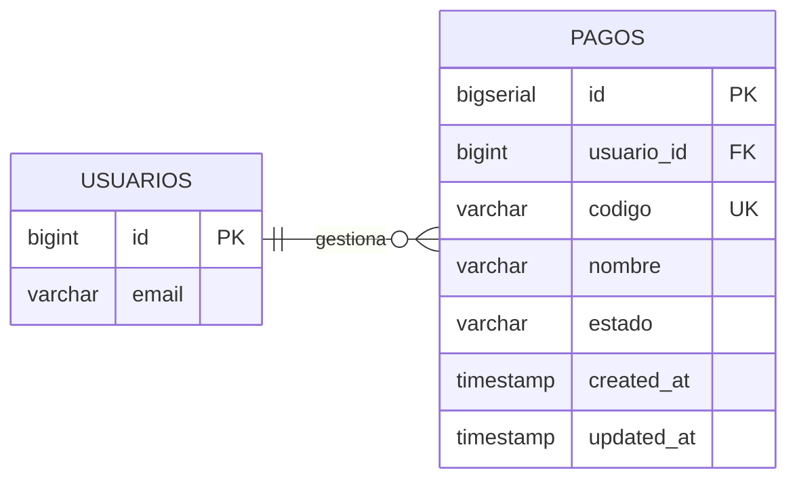

# Modelo de Datos y Persistencia [HU-002]

## 1. Diagrama Entidad-Relación (Mermaid)

## 2. Diccionario de Datos
| Columna | Tipo de Dato | Nulable | Clave | Descripción |
| :--- | :--- | :---: | :---: | :--- |
| `id` | `BIGSERIAL` | NO | `PK` | Identificador único |
| `usuario_id` | `BIGINT` | NO | `FK` | Usuario que creó el registro (trazabilidad brownfield a tabla usuarios) |
| `codigo` | `VARCHAR(50)` | NO | `UK` | Código único de negocio |
| `nombre` | `VARCHAR(150)` | NO | `N/A` | Nombre o descripción del registro |
| `estado` | `VARCHAR(20)` | NO | `CHECK` | Estado: PENDIENTE, ACTIVO, INACTIVO |
| `created_at` | `TIMESTAMP WITH TIME ZONE` | NO | `N/A` | Fecha de registro |
| `updated_at` | `TIMESTAMP WITH TIME ZONE` | NO | `N/A` | Fecha de última modificación |
