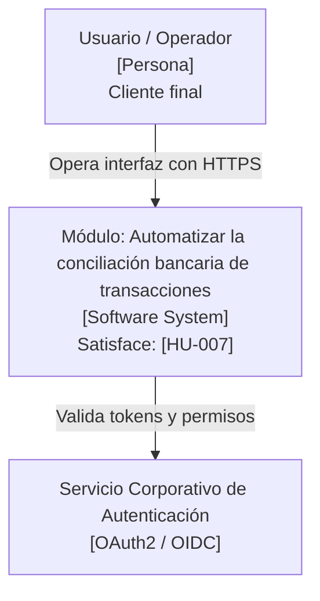
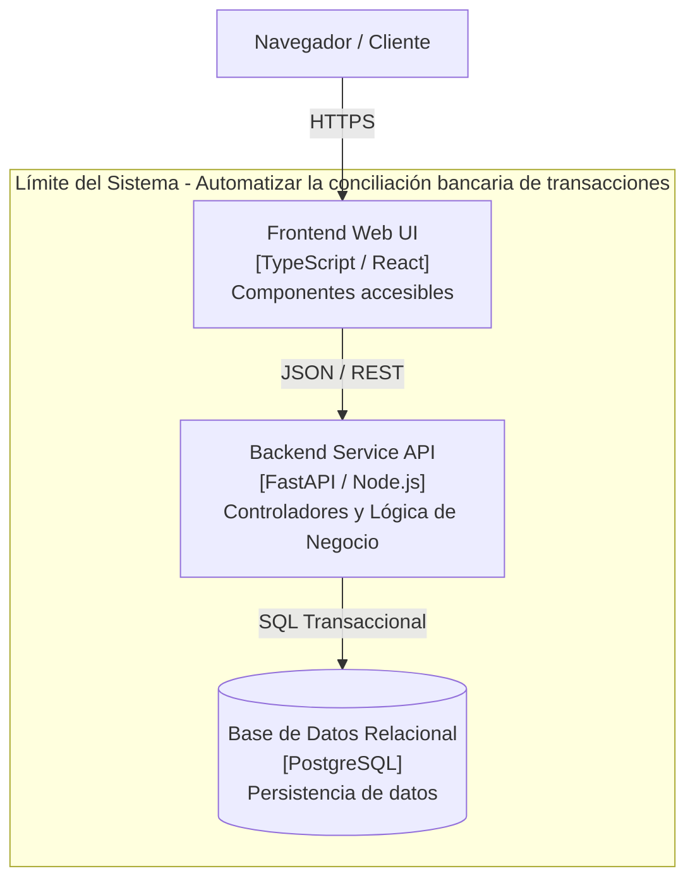
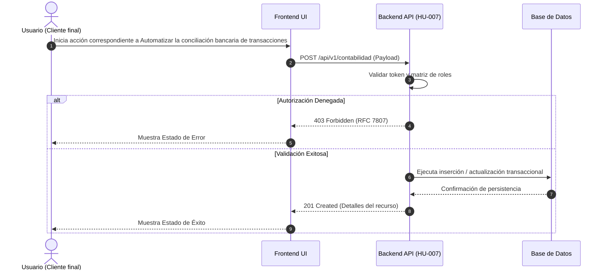

# Planos de Arquitectura e Integraciones [HU-007]

## 1. Diagrama de Contexto (C4 Nivel 1)

## 2. Diagrama de Contenedores (C4 Nivel 2)

## 3. Diagrama de Secuencia (Casos Críticos y Errores)

## 4. Registro de Decisiones de Arquitectura (ADRs)

### ADR-HU-007-01: Arquitectura Modular para Automatizar la conciliación bancaria de transacciones
* **Estado:** ACEPTADO
* **Contexto:** Se requiere implementar Automatizar la conciliación bancaria de transacciones satisfaciendo [HU-007]. Se evalúa la arquitectura con base en volumen estimado.
* **Decisión:** Implementar como servicio modular monolítico con persistencia relacional.
* **Justificación:** Evita sobreingeniería y complejidad operacional innecesaria ya que el tráfico no amerita microservicios distribuidos.

